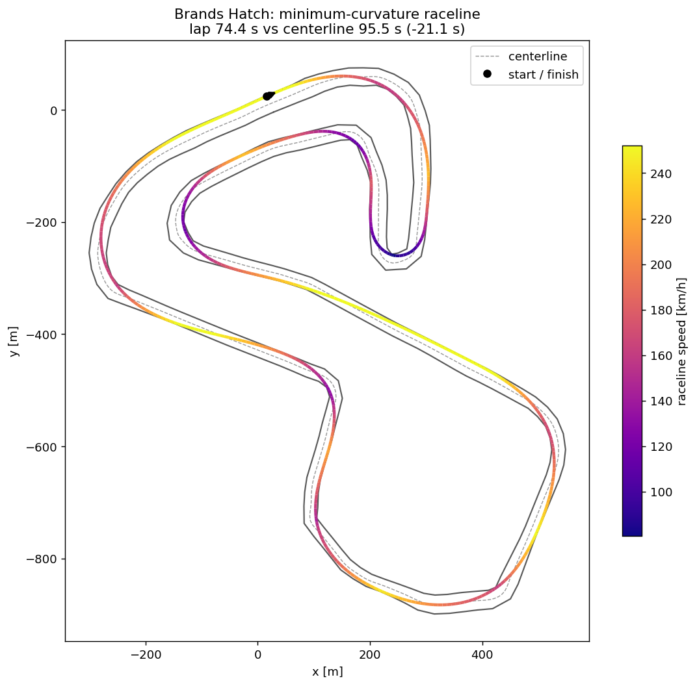
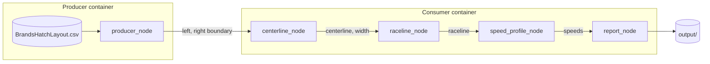
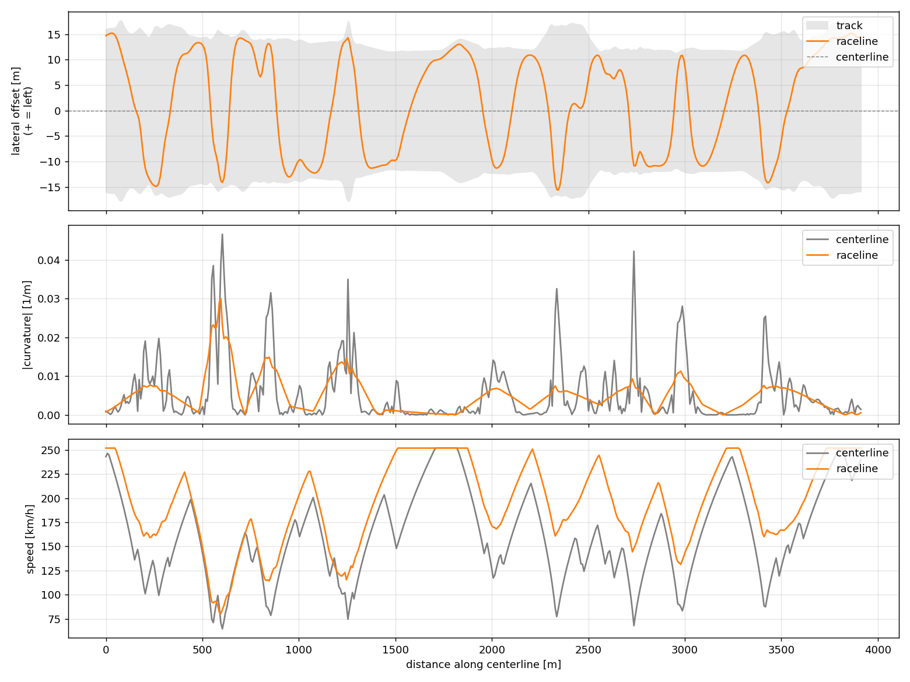

# BGR-race: minimum-curvature raceline pipeline (ROS 2 + Docker)

Two Docker containers, a **producer** and a **consumer**, talk over ROS 2 Jazzy. The producer publishes the
Brands Hatch track boundaries. The consumer runs a four-node pipeline that builds a centerline, optimizes a
**minimum-curvature raceline** and computes a **speed profile and lap time** for both lines. It then writes
the plots and data files.



| | Centerline | Raceline |
|---|---|---|
| Length | 3919.8 m | 3845.5 m |
| Max curvature | 0.0466 1/m (R ≈ 21 m) | 0.0300 1/m (R ≈ 33 m) |
| Min speed | 64.6 km/h | 80.5 km/h |
| **Lap time** | **95.47 s** | **74.36 s** (−21.1 s) |

---

## Quick start

Requirements: Docker with Compose v2. Nothing else is needed on the host.

```bash
git clone git@github.com:pinhas019/bgr-racing-autonomous-task.git && cd bgr-racing-autonomous-task
docker compose up --build
```

Both containers exit on their own when the pipeline is done, which takes about 10 s after the build. Results are written to `output/`:

| File | Content |
|---|---|
| `track.png` | Boundaries, centerline and raceline, colored by speed |
| `profiles.png` | Lateral offset, curvature and speed along the lap, for centerline and raceline |
| `pipeline_data.csv` | Every per-point value the pipeline computed (500 rows, see [Outputs](#outputs)) |
| `results.json` | Summary statistics. It is written last, so if it exists the run succeeded |

The consumer container exits with code `0` on success and `1` if the pipeline failed. The files in `output/` are
created by the container as root. You can still delete them, because `output/` itself belongs to you.

Unit tests (pure functions on synthetic tracks; no ROS graph is started):

```bash
docker compose run --rm --no-deps consumer bash -c '. /ws/install/setup.bash && python3 -m pytest -q /ws/tests'
```

---

## Dataset: `BrandsHatchLayout.csv`

| Property | Value |
|---|---|
| Format | CSV, columns `x, y, side` (`side` ∈ {`left`, `right`}), coordinates in metres |
| Rows | 314: 157 per side |
| Valid points | 156 per side. **Each side starts with one empty row** (`,,left` at line 2 and `,,right` at line 159), which the producer drops |
| Shape | Two closed polylines (inner/outer boundary), not explicitly closed (the last point ≠ the first) |
| Bounding box | x ∈ [−300.2, 548.6] m, y ∈ [−898.9, 74.8] m (≈ 850 × 975 m) |
| Track length (centerline) | 3919.8 m, which matches the Brands Hatch **GP** circuit (≈ 3.9 km) |
| Track width | min 22.6 m, mean 27.5 m, max 35.4 m |
| Point spacing | ≈ 25 m on average: a coarse polygon, so straight segments with kinks at the vertices |
| Driving direction | Given by the side labels: the left boundary is on the driver's left |

The track is wider than a typical racing surface (≈ 12–15 m). The data is used as given.

---

## Architecture



The report also subscribes to every upstream topic (it needs all of them for the plots). When it is done, it
publishes `/pipeline/status` to every node in both containers (see [Fault handling](#fault-handling)).

Both images are built from `ros:jazzy-ros-base` (Ubuntu 24.04, Python 3.12). The images share nothing but
standard ROS message types, so the contract between producer and consumer is just the topic list below.
The containers find each other through DDS multicast on the Compose bridge network (`ROS_DOMAIN_ID=42`).

```
producer/                      IMAGE 1: data acquisition
  Dockerfile
  data/BrandsHatchLayout.csv
  producer/                    ament_python package
    config/producer.yaml
    producer/producer_node.py
consumer/                      IMAGE 2: processing pipeline
  Dockerfile
  consumer/                    ament_python package
    config/pipeline.yaml       all algorithm / vehicle / output parameters
    config/launch.yaml         restart policy
    launch/pipeline.launch.py
    consumer/pipeline/         one node per stage
      centerline_node.py  raceline_node.py  speed_profile_node.py  report_node.py
      msg_utils.py             QoS, message <-> numpy conversion, Stage base class
  tests/test_pipeline.py
scripts/fault_test.sh          fault injection (kill a node mid-run)
docker-compose.yml
```

### Topics

All topics are `RELIABLE` + `TRANSIENT_LOCAL` (latched). A node that starts late, or restarts, still gets the
last message, so start order never matters.

| Topic | Type | Publisher | Content |
|---|---|---|---|
| `/track/left_boundary`, `/track/right_boundary` | `nav_msgs/Path` | producer | Raw boundary points |
| `/track/centerline` | `nav_msgs/Path` | centerline | 500 evenly spaced points (≈ 7.8 m) |
| `/track/width` | `std_msgs/Float64MultiArray` (500×2) | centerline | Distance to the left / right boundary |
| `/track/raceline` | `nav_msgs/Path` | raceline | 500 points |
| `/speed/centerline`, `/speed/raceline` | `std_msgs/Float64MultiArray` | speed_profile | Speed per point [m/s] |
| `/pipeline/status` | `std_msgs/String` | report | `success` or `failed: …`. Tells every node to exit |

Every stage file has a **pure numpy/scipy function** (the algorithm, unit-tested without ROS) and a thin
`Stage` node that waits for its inputs, calls the function once and publishes the result.

---

## Algorithms

### 1. Centerline (`centerline_node.py`)
1. Each boundary is interpolated with a **periodic cubic spline** (`scipy.interpolate.CubicSpline`,
   parameterized by chord length) and resampled densely (5000 points).
2. If needed, the right boundary is reversed so both boundaries run the same way round (sign of the polygon area).
3. For every left point, the nearest right point is found with `scipy.spatial.cKDTree`. The **midpoint** of each pair is a centerline candidate.
4. The midpoints are re-splined and resampled to 500 evenly spaced points. The distances to both boundaries are the widths.
5. The centerline is oriented so the left boundary lies on its left. This fixes the driving direction for the speed profile.

The spline interpolates the data exactly, with no smoothing: accuracy is preferred over a smooth-looking line.

### 2. Minimum-curvature raceline (`raceline_node.py`)
The raceline is the centerline shifted sideways along its normal: **pᵢ = cᵢ + αᵢ nᵢ**. Each offset αᵢ is bounded so
the car keeps a `margin` (1 m) from both boundaries. The optimization minimizes the curvature energy

  **E = Σ κᵢ² · dsᵢ**

where κᵢ is the **exact** curvature of the shifted points (1 / radius of the circle through pᵢ₋₁, pᵢ, pᵢ₊₁).
This is written as least-squares residuals rᵢ = κᵢ·√dsᵢ and solved with bounded Gauss–Newton
(`scipy.optimize.least_squares`, `trf`). Each rᵢ depends only on αᵢ₋₁..αᵢ₊₁. The cyclic-tridiagonal
`jac_sparsity` passed to scipy reduces the finite-difference Jacobian to a few function evaluations, so the solve takes ≈ 7 s.

A note on accuracy: the common shortcut of minimizing squared second differences (or linearizing κ around
the centerline) on a constant-radius corner gets the trend backwards and prefers the *inner* edge. With exact curvature, the
optimizer correctly picks the *outer* edge. The unit test `test_raceline_on_circle_hugs_outside` checks this.

### 3. Speed profile (`speed_profile_node.py`)
Point-mass model with parameters from `config/pipeline.yaml` (roughly a GT car):
`a_lat = 15 m/s²`, `a_acc = 8 m/s²`, `a_brk = 12 m/s²`, `v_top = 70 m/s`.

- Cornering limit: v ≤ min(v_top, √(a_lat / |κ|))
- Acceleration and braking limits: closed form with running minima (`np.minimum.accumulate`), no Python loops:
  - forward: vᵢ² = 2·a_acc·sᵢ + cummin(vlim² − 2·a_acc·s)
  - backward: vᵢ² = reverse-cummin(vlim² + 2·a_brk·s) − 2·a_brk·s
  - result: v = √min(forward, backward). This equals the usual forward-then-backward pass.
- The lap is closed, so the profile is computed over three unrolled laps and the middle one is kept.
- Lap time = Σ dsᵢ / mean(vᵢ, vᵢ₊₁).

### 4. Report (`report_node.py`)
Collects every topic, writes the outputs, then publishes `/pipeline/status`.

---

## Results



- The raceline uses the full track width (offsets up to 15.6 m) in the classic **outside → apex → outside** pattern.
  Peak curvature drops from 0.047 to 0.030 1/m, so the slowest corner (the hairpin at ≈ 600 m) is taken at 80 km/h instead of 65 km/h.
- The raceline is also 74 m shorter than the centerline.
- **Lap time: 95.5 s → 74.4 s.** The raceline keeps exactly the 1.0 m margin to the nearest boundary
  (`raceline_min_clearance_to_boundary_m` in `results.json`).

**Read the 21 s gain with care.** The boundaries are a coarse polygon (≈ 25 m spacing), so the
exact-interpolation centerline inherits the vertex kinks. These show up as curvature spikes in
`profiles.png` and force extra slow-downs on the centerline. The raceline optimizer removes them. Part of the gain is
therefore "smoothing the data" rather than "choosing a better line". The centerline was deliberately not smoothed, to keep it
faithful to the data.

### Outputs

`pipeline_data.csv`, one row per centerline sample:

| Column | Meaning |
|---|---|
| `s_m` | Distance along the centerline |
| `center_x`, `center_y` | Centerline point |
| `width_left_m`, `width_right_m` | Distance from the centerline to each boundary |
| `race_x`, `race_y`, `race_offset_m` | Raceline point and its lateral offset (+ = left) |
| `curvature_center`, `curvature_race` | Signed curvature [1/m] (+ = left turn) |
| `speed_center_mps`, `speed_race_mps` | Speed profile [m/s] |

---

## Fault handling

| Failure | What happens |
|---|---|
| A consumer node crashes (any non-zero exit, including a kill) | The launch file restarts it after 1 s, up to 3 times (`config/launch.yaml`). Clean exits are never restarted. The latched topics re-deliver its inputs and it recomputes |
| The producer crashes | Docker restarts the container (`restart: on-failure:3`). It re-publishes the same latched data |
| A node disconnects after delivering its data | Nothing is lost: the downstream nodes already hold the data, and latched topics re-deliver it to any node that restarts |
| Data never arrives (producer down, upstream stuck) | Every node gives up after `deadline_s`. The report publishes `failed: missing [...]`, writes no `results.json`, and the consumer exits with code 1 |
| Stale results from a previous run | The report deletes its output files at startup |
| Shutdown | No signals are used. When the report is done, it publishes `/pipeline/status` and waits (up to `ack_timeout_s`) until every node in both containers has acknowledged it. Each node then exits by itself |

To check crash recovery, hard-kill a node in the middle of a run and verify that the pipeline still succeeds:

```bash
scripts/fault_test.sh consumer lib/consumer/raceline_node "centerline: 500 pts"
scripts/fault_test.sh consumer lib/consumer/report_node   "centerline: 500 pts"
scripts/fault_test.sh producer lib/producer/producer_node "centerline: 500 pts"
```

---

## Configuration

There are no parameter defaults in code. A missing key stops the node at startup with an error naming the key.

| File | Keys |
|---|---|
| `producer/producer/config/producer.yaml` | `csv_path`, `deadline_s` |
| `consumer/consumer/config/pipeline.yaml` | `deadline_s` (all nodes), `n_samples`, `n_dense`, `margin`, `a_lat`, `a_acc`, `a_brk`, `v_top`, `track_name`, `output_dir`, `ack_timeout_s` |
| `consumer/consumer/config/launch.yaml` | `max_restarts`, `restart_delay_s` |

After editing a config file, rebuild the image (`docker compose up --build`).

---

## Limitations

- **Point-mass vehicle:** no combined grip (friction ellipse), drag, downforce, gears or power limit. Acceleration and braking limits
  are constant, so absolute lap times are optimistic. Comparing the two lines under the same model is the meaningful result.
- **Minimum curvature is not minimum time:** it is the standard fast and stable approximation. A minimum-time optimization would also
  trade path length against speed.
- **Centerline from nearest points:** pairing each left point with its nearest right point is robust for this track but can
  misbehave on very tight hairpins where the boundaries come close together.
- **Coarse input data:** see the note under [Results](#results).
