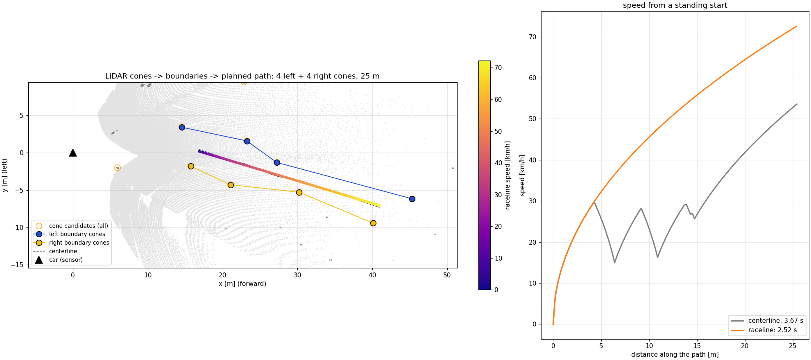
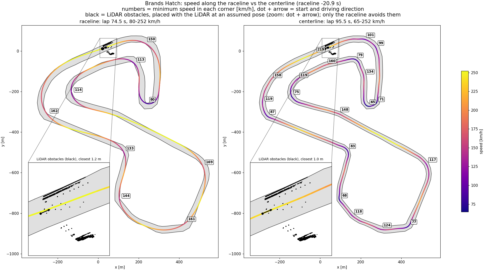
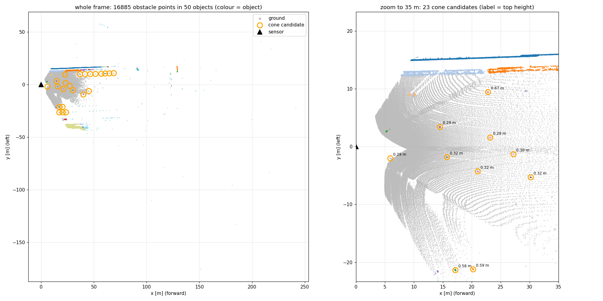
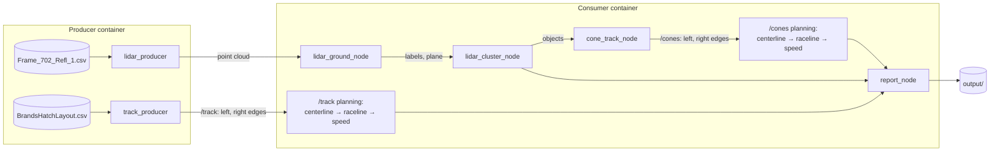
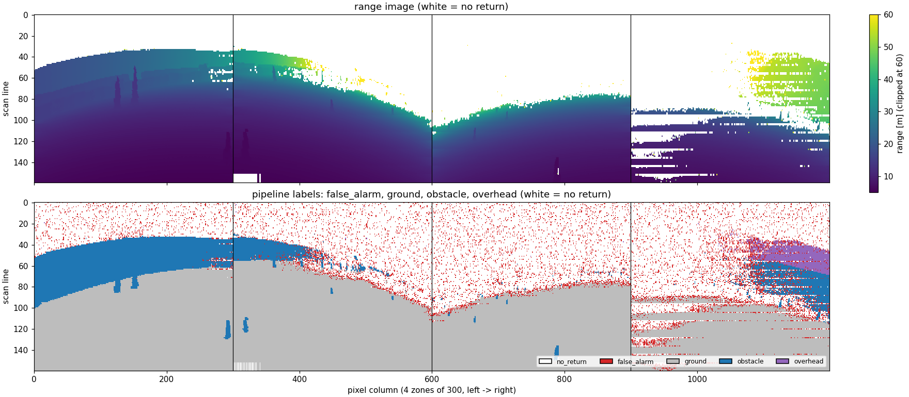

# BGR-race: driverless perception + planning pipeline (ROS 2 + Docker)

Two Docker containers, a **producer** and a **consumer**, talk over ROS 2 Jazzy. The producer publishes two
datasets, and the consumer runs the two halves of a driverless race-car software stack on them:

- **Perception (LiDAR):** one LiDAR frame is split into ground and obstacles with a robust **ground-plane fit**.
  The obstacles are clustered into objects, and **cone-sized objects** are flagged.
- **Planning:** from a track's left and right edges, compute a centerline, a **minimum-curvature raceline**, and a
  **speed profile and driving time** for both lines.
- **Perception → planning:** the cones found by the LiDAR are sorted into **left and right track edges**, and the
  *same planning nodes* then plan a path between them, exactly as a Formula Student car does on an unknown cone track.
  The planner also runs on the full **Brands Hatch** map, to show it on a complete 3.9 km lap.

```
LiDAR frame ─▶ ground + objects ─▶ cones ─▶ left/right edges ─┐
                                                               ├─▶ centerline ─▶ raceline ─▶ speed + time
Brands Hatch map ─▶ left/right edges ─────────────────────────┘        (same nodes, run once per source)
```

A final report node writes plots, tables and a summary for everything.



| Cone path from the LiDAR frame | Centerline | Raceline |
|---|---|---|
| Edges found | 4 left + 4 right cones, 5 gates | |
| Length | 25.4 m | 25.4 m |
| Top speed (from a standing start) | 54 km/h | 73 km/h |
| **Time start → end** | **3.67 s** | **2.52 s** |



| Brands Hatch map | Centerline | Raceline |
|---|---|---|
| Length | 3919.8 m | 3845.5 m |
| Max curvature | 0.0466 1/m (R ≈ 21 m) | 0.0300 1/m (R ≈ 33 m) |
| Min speed | 64.6 km/h | 80.5 km/h |
| **Lap time** | **95.47 s** | **74.36 s** (−21.1 s) |



| LiDAR frame 702 | |
|---|---|
| Pixels / returns | 192,000 / 119,781 |
| Ground plane | z = 0.0141·x + 0.0179·y − 1.081 m (tilt 1.31°, sensor 1.08 m above ground) |
| Points (ground / obstacle / overhead / false alarm) | 89,309 / 16,885 / 2,183 / 11,404 |
| Objects / cone candidates | 50 / 23 |

---

## Quick start

Requirements: Docker with Compose v2. Nothing else is needed on the host.

```bash
git clone git@github.com:pinhas019/bgr-racing-autonomous-task.git && cd bgr-racing-autonomous-task
docker compose up --build
```

Both containers exit on their own when the pipeline is done, which takes about 15 s after the build. Results are written to `output/`:

| File | Content |
|---|---|
| `track_speed.png` | **Speed map**: raceline and centerline side by side, each coloured by its speed (shared scale), with the minimum speed in every corner |
| `track_profiles.png` | Lateral offset, curvature and speed along the lap, for centerline and raceline |
| `track_data.csv` | Every per-point value of the track branch (500 rows) |
| `cone_path.png` | **Perception → planning**: LiDAR scene, the cones chosen as left / right edges, and the planned path coloured by speed; speed along the path |
| `cone_path_data.csv` | Every per-point value of the cone path (120 rows, same columns as `track_data.csv`) |
| `lidar_bev.png` | Bird's-eye view: ground, objects (one colour each) and cone candidates |
| `lidar_scan.png` | Range image and per-pixel labels in the sensor's own pixel layout |
| `lidar_points.csv` | Every pixel with every field, plus its label, height above ground and object id (192,000 rows, 14 MB; generated, not committed) |
| `lidar_objects.csv` | One row per object: size, position, top height, range, reflectivity, cone flag |
| `results.json` | Summary statistics: `track`, `lidar`, `cone_path`. It is written last, so if it exists the run succeeded |

The column meanings are listed under [Outputs](#outputs). The consumer container exits with code `0` on success
and `1` if the pipeline failed. The files in `output/` are created by the container as root. You can still delete
them, because `output/` itself belongs to you.

Unit tests (pure functions on synthetic tracks, LiDAR scenes and cone tracks; no ROS graph is started):

```bash
docker compose run --rm --no-deps consumer bash -c '. /ws/install/setup.bash && python3 -m pytest -q /ws/tests'
```

---

## Datasets

### `BrandsHatchLayout.csv`: track boundaries

| Property | Value |
|---|---|
| Format | CSV, columns `x, y, side` (`side` ∈ {`left`, `right`}), coordinates in metres |
| Rows | 314: 157 per side |
| Valid points | 156 per side. **Each side starts with one empty row** (`,,left` at line 2 and `,,right` at line 159), which the producer drops |
| Shape | Two closed polylines (inner/outer boundary), not explicitly closed (the last point ≠ the first) |
| Bounding box | x ∈ [−300.2, 548.6] m, y ∈ [−898.9, 74.8] m (≈ 850 × 975 m) |
| Track length (centerline) | 3919.8 m, which matches the Brands Hatch **GP** circuit (≈ 3.9 km) |
| Track width | min 22.6 m, mean 27.5 m, max 35.4 m |
| Point spacing | ≈ 25 m on average: a coarse polygon, so straight segments with kinks at the vertices |
| Driving direction | Given by the side labels: the left boundary is on the driver's left |

The track is wider than a typical racing surface (≈ 12–15 m). The data is used as given.

### `Frame_702_Refl_1.csv`: one LiDAR frame

| Property | Value |
|---|---|
| Capture | Frame 702, 2022-11-27 12:47:56.996 (`Epoch time (usec)` 1669546076996195) |
| Format | CSV, one row per pixel. Columns: `Frame, Timestamp, Epoch time (usec), Pixel Number, Distance, Reflectivity, Probability of False Alarm, x, y, z, theta, phi` |
| Units | **Centimetres** for `Distance` and `x, y, z` (`Distance` = ‖xyz‖ to within 0.1%). The producer converts them to metres. Angles are in degrees |
| Pixel layout | 192,000 pixels = **4 azimuth zones × 160 scan lines × 300 pixels**. A 300-pixel row covers ≈ 30° of azimuth, the 4 zones together cover θ ∈ [−59°, +58°], and lines span φ ∈ [−11°, +9°]. The angular step is ≈ 0.1° in both directions |
| Returns | 119,781 pixels (62.4%) have a return. **72,219 (37.6%) have none** (`Distance = 0`, mostly sky), but they still carry projected `x, y, z`, so validity must be judged by `Distance`, not by the coordinates |
| Range of returns | 5.07–244.25 m, median 12.9 m |
| Reflectivity | 0–222, median 13 |
| Probability of false alarm | 1e-4 to 1. 89% of returns sit at the minimum (1e-4). The share above 1e-3 grows with range: 1% below 20 m, 9% at 20–40 m, 36% at 40–80 m, 96% beyond 80 m |
| Axes | x forward, y left, z up. The ground is at z ≈ −1.08 m, so the sensor is mounted about 1.1 m high |
| Scene | Flat paved area with long barriers or walls at y ≈ +13…+16 m, and small objects arranged like a cone course |

---

## Architecture



The two planning boxes are **the same three nodes** (`centerline_node`, `raceline_node`, `speed_profile_node`),
launched twice in different ROS namespaces. They use relative topic names, so in namespace `/cones` they read
`/cones/left_boundary` and write `/cones/raceline`, and in `/track` the same for `/track/...`. Only their config
differs: open path or closed lap, straight or curved edges, and the car.

The report also subscribes to every upstream topic (it needs all of them for the plots). When it is done, it
publishes `/pipeline/status` to every node in both containers (see [Fault handling](#fault-handling)).

Both images are built from `ros:jazzy-ros-base` (Ubuntu 24.04, Python 3.12). The images share nothing but
standard ROS message types, so the contract between producer and consumer is just the topic list below.
The containers find each other through DDS multicast on the Compose bridge network (`ROS_DOMAIN_ID=42`).

```
producer/                      IMAGE 1: data acquisition
  Dockerfile
  data/                        BrandsHatchLayout.csv, Frame_702_Refl_1.csv
  producer/                    ament_python package
    config/producer.yaml       dataset paths, units, deadlines
    config/launch.yaml         restart policy
    launch/producer.launch.py
    producer/
      track_producer_node.py  lidar_producer_node.py
      common.py                QoS, config parameters, source-node lifecycle
consumer/                      IMAGE 2: processing pipeline
  Dockerfile
  consumer/                    ament_python package
    config/pipeline.yaml       all algorithm / vehicle / sensor / output parameters
    config/launch.yaml         restart policy
    launch/pipeline.launch.py
    consumer/pipeline/         one node per stage
      lidar_ground_node.py  lidar_cluster_node.py   perception
      cone_track_node.py                           perception -> planning bridge
      centerline_node.py  raceline_node.py  speed_profile_node.py   planning (run as /track and /cones)
      report_node.py  lidar_report.py
      msg_utils.py             QoS, message <-> numpy conversion, Stage base class
  tests/test_pipeline.py  tests/test_lidar.py  tests/test_cone_track.py
scripts/fault_test.sh          fault injection (kill a node mid-run)
docker-compose.yml
```

### Topics

All topics are `RELIABLE` + `TRANSIENT_LOCAL` (latched). A node that starts late, or restarts, still gets the
last message, so start order never matters.

| Topic | Type | Publisher | Content |
|---|---|---|---|
| `/track/left_boundary`, `/track/right_boundary` | `nav_msgs/Path` | track_producer | Brands Hatch edges |
| `/cones/left_boundary`, `/cones/right_boundary` | `nav_msgs/Path` | cone_track | Edges built from LiDAR cones (cone positions in driving order) |
| `/<ns>/centerline` | `nav_msgs/Path` | `<ns>`/centerline | Evenly spaced points (500 for `track`, 120 for `cones`) |
| `/<ns>/width` | `std_msgs/Float64MultiArray` (n×2) | `<ns>`/centerline | Distance to the left / right edge |
| `/<ns>/raceline` | `nav_msgs/Path` | `<ns>`/raceline | Same number of points as the centerline |
| `/<ns>/speed/centerline`, `/<ns>/speed/raceline` | `std_msgs/Float64MultiArray` | `<ns>`/speed_profile | Speed per point [m/s] |
| `/lidar/points` | `sensor_msgs/PointCloud2`, organized 640×300 (6.9 MB) | lidar_producer | **Every pixel** with fields `x, y, z, distance` (m), `reflectivity, pfa, theta, phi, pixel`; stamped with the capture time |
| `/lidar/labels` | `std_msgs/Int32MultiArray` (640×300) | lidar_ground | Per-pixel label: 0 no return, 1 false alarm, 2 ground, 3 obstacle, 4 overhead |
| `/lidar/ground_plane` | `std_msgs/Float64MultiArray` (3) | lidar_ground | Plane coefficients a, b, c |
| `/lidar/cluster_ids` | `std_msgs/Int32MultiArray` (640×300) | lidar_cluster | Per-pixel object id (−1 = none) |
| `/lidar/clusters` | `std_msgs/Float64MultiArray` (objects × 12, column names in the layout) | lidar_cluster | Object table |
| `/pipeline/status` | `std_msgs/String` | report | `success` or `failed: …`. Tells every node to exit |

`<ns>` is `track` or `cones`. Every stage file has a **pure numpy/scipy function** (the algorithm, unit-tested without ROS) and a thin
`Stage` node that waits for its inputs, calls the function once and publishes the result.

---

## Algorithms: perception (LiDAR)

### 1. Ground plane and labels (`lidar_ground_node.py`)
1. **Untrusted pixels are set aside:** pixels without a return (`distance = 0`) and returns whose probability of false alarm is above `max_pfa`
   (1e-3). The false alarms are mostly isolated points in the sky and at long range. They show as red speckle in `lidar_scan.png`.
2. **Robust plane fit:** z = a·x + b·y + c is fitted to the trusted returns within `fit_range` (40 m) using
   `scipy.optimize.least_squares` with a **Cauchy loss** (`f_scale` 5 cm). Residuals much larger than 5 cm, such as walls, cones or
   cars, barely influence the fit, so no RANSAC sampling is needed. The fit takes about 0.1 s.
3. **Height above the plane splits the returns:** below `ground_tol` (15 cm) is ground, below `max_height` (3 m) is an obstacle,
   anything higher is overhead.

### 2. Objects and cone candidates (`lidar_cluster_node.py`)
1. **Euclidean clustering:** obstacle points closer than `radius` (0.5 m) are linked (`cKDTree.query_pairs`), and every connected
   component of that graph (`scipy.sparse.csgraph.connected_components`) is one object. Groups smaller than `min_points` (5) count as noise.
   Because the angular step is ≈ 0.1°, neighbouring points are < 0.45 m apart even at 250 m, so one radius works at every range.
2. **Per-object statistics** come from `scipy.ndimage` (min / max / mean by label): point count, centre, bounding-box size, top height above
   ground, range and mean reflectivity.
3. **Cone candidates:** footprint max(size_x, size_y) ≤ 0.5 m and top height between 0.15 and 0.8 m. For reference,
   Formula Student cones are 0.325 m (small) and 0.505 m (large) tall.

## Algorithms: from cones to track edges

### 3. Cone track (`cone_track_node.py`)
The LiDAR sees no colour (real Formula Student tracks use blue cones on the left and yellow on the right), so
which cone belongs to which edge has to come from geometry alone. Cones along one edge are about as far apart (≈ 5–6 m)
as cones across the track, so distance alone cannot decide it either.
1. **Track cones:** cone candidates with the track's cone height (0.20–0.40 m, the small FS cone). The taller posts are excluded.
2. **Candidate gates:** a Delaunay triangulation (`scipy.spatial.Delaunay`) connects neighbouring cones. Edges 3–7 m long
   (about one track width; 3 m is the FS minimum) may be *gates*, with one cone on each side of the track.
3. **Walk from the car:** start at the car, heading forward, and repeatedly step to the nearest gate midpoint that is
   - within `max_step` (16 m, which allows a few missing or hidden cones);
   - within `max_turn` (60°) of the current heading;
   - **across** the direction of travel (within 50° of perpendicular).

   The last test is what rejects edges between two cones of the *same* edge. Those also have track-width length, but they run *along* the track.
4. **Sides:** each gate cone to the left of the travel direction goes on the left edge, the others on the right edge, in walk order.
5. A frame with fewer than 3 gates has no cone track. The node fails, and the report says so.

On the real frame: 10 track cones → 5 gates → 4 left + 4 right cones, matching the cone layout in `cone_path.png`.
The walk never reaches the cone 26 m to the side.

## Algorithms: planning

The same three nodes plan on both sources. Per namespace, the config chooses:

| Setting | `/track` (Brands Hatch map) | `/cones` (LiDAR cones) | Why |
|---|---|---|---|
| `closed` | `true`: a lap | `false`: a path from the first gate onward | A map is a full loop; a LiDAR sees the next few tens of metres |
| `interpolation` | `cubic` | `linear` | Map edges are a coarse polygon of a smooth track; a cone track's edges *are* straight lines between cones |
| `jacobian` | `sparse` | `dense` | Measured: 500 points, sparse 7 s vs dense 41 s; 120 points, dense 0.5 s vs sparse 84 s |
| Car | GT-like, `v_top` 70 m/s | Formula Student, `v_top` 30 m/s, standing start | |


### 4. Centerline (`centerline_node.py`)
1. Each edge is resampled densely (5000 points): with a **cubic spline** (`scipy.interpolate.CubicSpline`, periodic for a lap,
   natural for an open path) or with straight segments.
2. If needed, the right edge is reversed so both edges run the same way (sign of the polygon area for a lap, end-to-end direction for a path).
3. For every left point, the nearest right point is found with `scipy.spatial.cKDTree`. The **midpoint** of each pair is a centerline candidate.
4. The midpoints are re-splined and resampled to evenly spaced points. The distances to both edges are the widths.
   On an open path, the part where one edge runs on past the end of the other is dropped.
5. The centerline is oriented so the left boundary lies on its left. This fixes the driving direction for the speed profile.

Both interpolations pass exactly through the data, with no smoothing: accuracy is preferred over a smooth-looking line.
A natural spline through only 4 cones bulges between them (it narrowed the corridor to 1.8 m), which is why the cone edges are linear (min width 3.1 m).

### 5. Minimum-curvature raceline (`raceline_node.py`)
The raceline is the centerline shifted sideways along its normal: **pᵢ = cᵢ + αᵢ nᵢ**. Each offset αᵢ is bounded so
the car keeps a `margin` (1 m) from both boundaries. The optimization minimizes the curvature energy

  **E = Σ κᵢ² · dsᵢ**

where κᵢ is the **exact** curvature of the shifted points (1 / radius of the circle through pᵢ₋₁, pᵢ, pᵢ₊₁).
This is written as least-squares residuals rᵢ = κᵢ·√dsᵢ and solved with bounded Gauss–Newton
(`scipy.optimize.least_squares`, `trf`). Each rᵢ depends only on αᵢ₋₁..αᵢ₊₁. For the 500-point lap (`jacobian: sparse`),
the cyclic-tridiagonal `jac_sparsity` passed to scipy reduces the finite-difference Jacobian to a few function evaluations, so
the solve takes ≈ 7 s. For the 120-point cone path (`jacobian: dense`), the exact dense trust-region solver converges in ≈ 0.5 s.
On an open path the end points have no curvature term, since they have only one neighbour.

A note on accuracy: the common shortcut of minimizing squared second differences (or linearizing κ around
the centerline) on a constant-radius corner gets the trend backwards and prefers the *inner* edge. With exact curvature, the
optimizer correctly picks the *outer* edge. The unit test `test_raceline_on_circle_hugs_outside` checks this.

### 6. Speed profile (`speed_profile_node.py`)
Point-mass model with parameters from `config/pipeline.yaml`:
`a_lat = 15 m/s²`, `a_acc = 8 m/s²`, `a_brk = 12 m/s²`, and `v_top` = 70 m/s (track) or 30 m/s (cones).

- Cornering limit: v ≤ min(v_top, √(a_lat / |κ|))
- Acceleration and braking limits: closed form with running minima (`np.minimum.accumulate`), no Python loops:
  - forward: vᵢ² = 2·a_acc·sᵢ + cummin(vlim² − 2·a_acc·s)
  - backward: vᵢ² = reverse-cummin(vlim² + 2·a_brk·s) − 2·a_brk·s
  - result: v = √min(forward, backward). This equals the usual forward-then-backward pass.
- A closed lap is computed over three unrolled laps and the middle one is kept, so the start/finish wraps correctly.
  An open path starts at `v_start` (0, a standing start, because one frame gives no ego speed) and ends unconstrained.
- Time = Σ dsᵢ / mean(vᵢ, vᵢ₊₁): one lap, or start to end of the path.

### 7. Report (`report_node.py`, `lidar_report.py`)
Collects every topic, writes all outputs, then publishes `/pipeline/status`. `lidar_scan.png` stitches the 4 zones side by side
into a 160 × 1200 panorama in the sensor's own pixel layout. The horizon runs continuously across the zone borders, which confirms the layout.

---

## Results

### Brands Hatch map


- **Speed map** (top of this page): on the raceline every corner is taken faster, and the slowest corner, the hairpin, rises from
  65 to 80 km/h. The centerline shows 20 corner dips against 9 on the raceline. Most of the extra dips come from the kinks in the boundary data (see below).
- The raceline uses the full track width (offsets up to 15.6 m) in the classic **outside → apex → outside** pattern.
  Peak curvature drops from 0.047 to 0.030 1/m, so the slowest corner (the hairpin at ≈ 600 m) is taken at 80 km/h instead of 65 km/h.
- The raceline is also 74 m shorter than the centerline.
- **Lap time: 95.5 s → 74.4 s.** The raceline keeps exactly the 1.0 m margin to the nearest boundary
  (`track.raceline_min_clearance_to_boundary_m` in `results.json`).

**Read the 21 s gain with care.** The boundaries are a coarse polygon (≈ 25 m spacing), so the
exact-interpolation centerline inherits the vertex kinks. These show up as curvature spikes in
`track_profiles.png` and force extra slow-downs on the centerline. The raceline optimizer removes them. Part of the gain is
therefore "smoothing the data" rather than "choosing a better line". The centerline was deliberately not smoothed, to keep it
faithful to the data.

### LiDAR



- **The ground is a clean plane:** z = 0.0141·x + 0.0179·y − 1.081 m. The 1.3° tilt reflects how the sensor is mounted on the car.
  Within 40 m, the median height of returns above the plane is 5 mm.
- **Point budget:** of the 192,000 pixels, 37.6% have no return (sky) and 5.9% are false alarms. 46.5% are ground, 8.8% are obstacles,
  and 1.1% are overhead (a tall structure at long range on the right).
- **50 objects:** the largest are the barriers along y ≈ +13…+16 m (up to 48 m long and 1.5 m high) and a structure at (30, −40) m.
- **23 cone candidates**, in three groups (the positions are in `results.json` → `lidar.cone_candidates`):
  - 9 objects with a top height of **0.28–0.32 m**, scattered 6–45 m ahead in a slalom-like pattern. This matches a small FS cone (0.325 m) very well.
  - 9 objects of **0.45–0.79 m** in a row along y ≈ +10 m, mostly 4–5 m apart, beside the barrier. These are taller than a large cone, so they are probably posts.
  - 5 objects of **0.40–0.60 m** in a 2 × 3 block at y ≈ −21…−26 m. They fit large cones (0.505 m) or stacked cones.

  From one frame, geometry alone cannot tell these groups apart for certain. That is why they are reported as *candidates* with their heights.

### Cone path (perception → planning)


- **Edges:** the 4 left (blue) and 4 right (yellow) cones form a gently right-bending corridor, 3.1–6.1 m wide (mean 4.3 m), starting
  at the first gate about 15 m ahead of the car.
- **Raceline:** the corridor is wide enough for a **straight line** to pass with at least 1.4 m to every edge. A straight line has zero
  curvature, so that is the exact minimum-curvature answer (energy 0.376 → 0.000).
- **Speed:** from a standing start the raceline is acceleration-limited all the way, reaching 73 km/h after 25 m in **2.52 s**.
  The centerline needs **3.67 s**: with straight-line edges it bends at every cone (sharpest bend radius 1.2 m) and has to slow down
  for each bend. As on Brands Hatch, part of the gain comes from how coarse the edges are, here only 4 cones per side.

### Outputs

`track_data.csv` and `cone_path_data.csv`, one row per centerline sample:

| Column | Meaning |
|---|---|
| `s_m` | Distance along the centerline |
| `center_x`, `center_y` | Centerline point |
| `width_left_m`, `width_right_m` | Distance from the centerline to each boundary |
| `race_x`, `race_y`, `race_offset_m` | Raceline point and its lateral offset (+ = left) |
| `curvature_center`, `curvature_race` | Signed curvature [1/m] (+ = left turn) |
| `speed_center_mps`, `speed_race_mps` | Speed profile [m/s] |

`lidar_points.csv`, one row per pixel, in the sensor's pixel order:

| Column | Meaning |
|---|---|
| `x, y, z, distance` | Position and range [m] (converted from cm) |
| `reflectivity, pfa, theta, phi, pixel` | As in the source file (`pfa` = probability of false alarm) |
| `label` | 0 no return, 1 false alarm, 2 ground, 3 obstacle, 4 overhead |
| `height_above_ground_m` | Signed height above the fitted ground plane |
| `object_id` | Row in `lidar_objects.csv`, or −1 |

`lidar_objects.csv`, one row per object: `id, n_points, x, y, z` (centre), `size_x, size_y, size_z` (bounding box),
`top_height` (above ground), `range`, `mean_reflectivity`, `is_cone` (0/1).

---

## Fault handling

| Failure | What happens |
|---|---|
| A node crashes (any non-zero exit, including a kill), in either container | The container's launch file restarts it after 1 s, up to 3 times (`config/launch.yaml`). Clean exits are never restarted. The latched topics re-deliver its inputs and it recomputes, or, for a source node, re-publishes |
| The producer container itself fails | Docker restarts it (`restart: on-failure:3`) |
| A node disconnects after delivering its data | Nothing is lost: the downstream nodes already hold the data, and latched topics re-deliver it to any node that restarts |
| Data never arrives (producer down, upstream stuck) | Every node gives up after `deadline_s`. The report publishes `failed: missing [...]`, writes no `results.json`, and the consumer exits with code 1 |
| Stale results from a previous run | The report deletes its output files at startup |
| Shutdown | No signals are used. When the report is done, it publishes `/pipeline/status` and waits (up to `ack_timeout_s`) until every node in both containers has acknowledged it. Each node then exits by itself |

To check crash recovery, hard-kill a node in the middle of a run and verify that the pipeline still succeeds:

```bash
scripts/fault_test.sh consumer lib/consumer/raceline_node "centerline: 500 pts"   # kills both /track and /cones raceline
scripts/fault_test.sh consumer lib/consumer/cone_track_node "track cones"
scripts/fault_test.sh consumer lib/consumer/report_node   "centerline: 500 pts"
scripts/fault_test.sh producer lib/producer/track_producer_node "centerline: 500 pts"
```

---

## Configuration

There are no parameter defaults in code. A missing key stops the node at startup with an error naming the key.

| File | Keys |
|---|---|
| `producer/producer/config/producer.yaml` | `deadline_s`; track: `csv_path`, `frame_id`; LiDAR: `csv_path`, `unit_scale`, `scan_width`, `frame_id` |
| `producer/producer/config/launch.yaml` | `max_restarts`, `restart_delay_s` |
| `consumer/consumer/config/pipeline.yaml` | `deadline_s` (all nodes); planning, separately for `/track/...` and `/cones/...`: `closed`, `interpolation`, `n_samples`, `n_dense`, `margin`, `jacobian`, `a_lat`, `a_acc`, `a_brk`, `v_top`, `v_start` (open paths); cone track: `track_cone_min_height`, `track_cone_max_height`, `gate_min_width`, `gate_max_width`, `max_step`, `max_turn_deg`, `max_gate_skew_deg`, `min_gates`; LiDAR: `max_pfa`, `fit_range`, `robust_scale`, `ground_tol`, `max_height`, `radius`, `min_points`, `cone_max_footprint`, `cone_min_height`, `cone_max_height`; report: `track_name`, `corner_drop_kmh`, `output_dir`, `ack_timeout_s`, `scan_zones`, `bev_zoom_range` |
| `consumer/consumer/config/launch.yaml` | `max_restarts`, `restart_delay_s` |

After editing a config file, rebuild the images (`docker compose up --build`).

---

## Limitations

- **Point-mass vehicle:** no combined grip (friction ellipse), drag, downforce, gears or power limit. Acceleration and braking limits
  are constant, so absolute lap times are optimistic. Comparing the two lines under the same model is the meaningful result.
- **Minimum curvature is not minimum time:** it is the standard fast and stable approximation. A minimum-time optimization would also
  trade path length against speed.
- **Centerline from nearest points:** pairing each left point with its nearest right point is robust for this track but can
  misbehave on very tight hairpins where the boundaries come close together.
- **Coarse edges:** see the notes under [Results](#brands-hatch-map). This applies to the cone path too (4 cones a side).
- **Single LiDAR frame:** there is no motion, so no tracking, mapping or ego-motion. Detections cannot be confirmed over time.
- **Flat-ground assumption:** one plane is fitted within 40 m and applied to the whole frame. On sloped or uneven ground the far range would
  need a piecewise or grid-based ground model.
- **Cone path starts at the first gate,** about 15 m ahead of the car. The stretch from the car to that gate has only one cone
  on its right, so it is not planned.
- **Cone sides from geometry only:** the gate walk needs gates ahead within `max_step` and `max_turn`. Hairpins tighter than
  that, or long gaps in the cones, end the walk early. It is tuned on Formula Student rules (track ≥ 3 m wide), not on many recordings.
- **Cone classification by size only:** the colour and stripes of a cone are not visible to this sensor. Reflectivity is reported per object but not used.
  Merged neighbours (two cones closer than 0.5 m) form one object.
